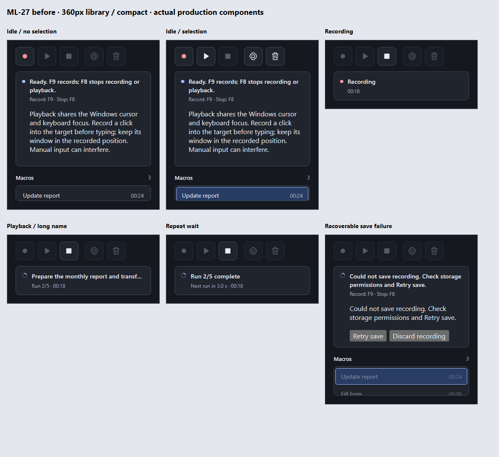
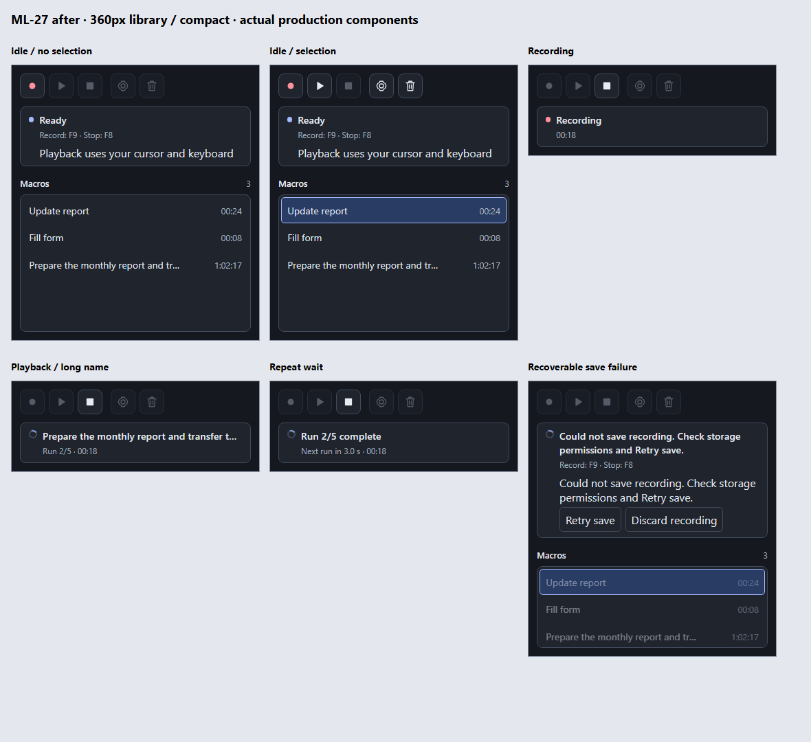
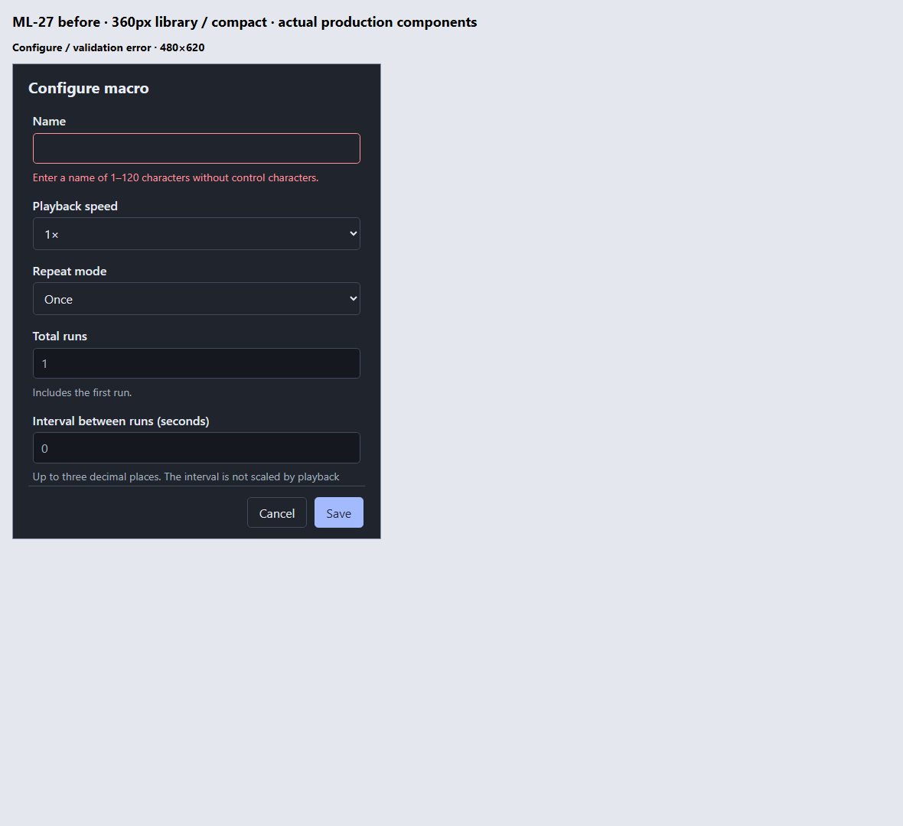
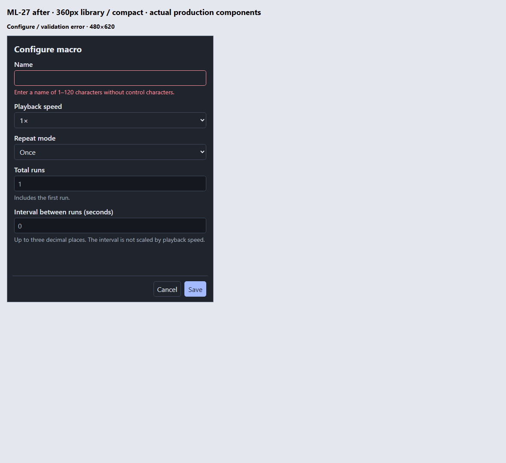
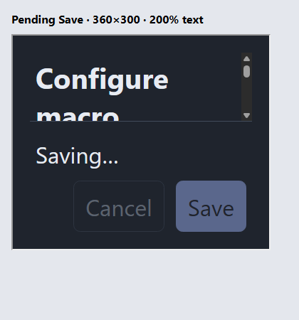

# ML-27 — UI density (#46)

Implementation issue: [#46](https://github.com/Dzahc/MacroLoom/issues/46).
The issue is titled ML-27; this change keeps the current
`feature/ml-27-reduce-ui-sizing-spacing-and-banner-copy` branch.

## Owner decisions

The October 25, 2026 interview supersedes these parts of the original issue:

- Retain compact's existing 360px minimum and content measurement. Empty horizontal
  space is acceptable to preserve playback messages. Native width constraints,
  focus handling, bounds/collision checks, and restoration are unchanged.
- Preserve recording, playback, preparation, finishing, countdown, and stopping
  copy and the two-line ordinary compact status layout.
- Preserve success/failure toast copy, appearance, dismissal, and delivery.
- Replace the long idle advice with exactly “Playback uses your cursor and keyboard”.
  No longer version, tooltip, or help disclosure is requested.
- Shorten the backend's normal idle message to “Ready”; the existing dedicated
  shortcut line supplies the instructions once. Global Play's hint remains owned
  by its separate story; no unavailable shortcut is advertised by this change.

## Shared sizing

Tokens live in `app/src/style.css` and are reused by `configure.css` and
`rename.css`. Values below assume the default 16px root. Rem units scale with text;
font sizes, theme colors, and focus indicators are retained.

| Token                  | Value                 | Use                                      |
| ---------------------- | --------------------- | ---------------------------------------- |
| `--space-label`        | 0.25rem / 4px         | Label/field and hint spacing             |
| `--space-control`      | 0.375rem / 6px        | Toolbar gaps, vertical control padding   |
| `--space-inline`       | 0.5rem / 8px          | Horizontal input padding, inline gaps    |
| `--space-panel`        | 0.75rem / 12px        | Panel padding and field-group spacing    |
| `--control-size`       | 2.25rem / 36px        | Toolbar buttons and minimum field height |
| `--toolbar-icon-size`  | 1.125rem / 18px       | Toolbar glyphs only                      |
| `--library-min-height` | Control + 3rem / 84px | One library row, heading, and padding    |

The extra Configure toolbar separator is also 6px. Library rows retain stable-ID
selection and ellipsis/full accessible names. Their rename target is 36px; row
height includes its border. Inline rename Save/Cancel controls are also 36px.
Recovery, context-menu, and delete-dialog controls share the same spacing scale.
Toast glyphs and dismiss-button padding explicitly retain their earlier sizes.

Small full windows scroll the outer library panel instead of collapsing its list.
Both panel and list scroll offsets are retained across compact/full transitions.
Configure keeps one field scroller and a persistent footer. Its title now scrolls
with the fields so a wrapped enlarged title cannot push Save/Cancel below the
viewport. The default full (600×480), minimum full (360×230), default Configure
(480×620), and minimum Configure (360×300) native sizes are unchanged.

## Before/after evidence

These are isolated Chromium renders of the actual `LibraryView`, `SessionControls`,
and `ConfigureForm` components, using controlled snapshots and the production CSS.
They do not execute native input or persistence. Before uses the original source
at `cdcadd350264bdc169e7a9d34d21ea4e2b3b5ef1`; after uses this worktree.
Library cards are 360×400 CSS pixels; compact cards use measured content height.
Configure is 480×620. Captures use rendering scale 1 and the dark theme.

The library comparisons include idle without/with selection, recording, playback
with a long name, repeat wait, and a recoverable save failure. Configure includes
a name-validation error and the persistent actions.

## Automated validation

- Existing rendered-component seam: the brief idle reminder renders alone,
  while cleanup and failed-save recovery controls remain actionable in their
  respective views. The new reminder regression failed before the copy change
  and passed afterward.
- Existing native session-command/snapshot seam: the initial idle message is
  exactly “Ready”. The new regression failed against the former repeated
  instructions and passed after the change.
- TypeScript checks passed during implementation. Targeted Configure and session
  rendering checks passed (14 tests); the targeted native idle-copy test passed.
- Public scroll-restoration checks cover both scroll surfaces and the empty
  library (2 tests).
- The isolated renderer passed 96 layout probes: eight states (idle with/without
  selection, recording, playback, repeat wait, recoverable save failure, Configure
  validation error, Configure pending Save), two text sizes (100%/200%), both
  themes, and rendering scales 1/1.25/1.5. Full and Configure probes use their
  minimum logical sizes. Theme media conditions are forced in the fixtures;
  rendering scale is a Chromium setting, not a Windows display-setting change.
  [Raw measurements](assets/ML-27/layout-audit.json) record zero failed geometry
  checks: visible-width button bounds, minimum button targets, a noncollapsed
  library/field scroller, and a contained Configure footer. Compact probes use
  the production `measureCompact` function until width and height settle.
  Ordinary recording/playback/repeat banners share the same measured height
  within each case; at default text the window is 360×130–131 CSS pixels.
- Initial `npm.cmd --prefix app run verify` passed with exit code 0. All 14 gate checks
  passed, including refreshed `origin`, formatting, TypeScript, ESLint, production
  build, Clippy, 104 frontend/tooling tests, 123 Rust unit tests and 22 repository
  integration tests, 33 Python quality fixtures, and 253 function complexity
  checks (limit 10, zero failures). Seven interactive Windows tests remain
  explicitly ignored by the ordinary test suite; this is not native UI evidence.
  The result is also recorded in the
  [issue validation comment](https://github.com/Dzahc/MacroLoom/issues/46#issuecomment-6404236543).

## Review

The implementation skill's parallel Standards and Spec reviews used clean starting
commit `cdcadd350264bdc169e7a9d34d21ea4e2b3b5ef1` as the fixed point and inspected
the uncommitted implementation plus this evidence. Standards: no remaining
findings. Spec: no confirmed code defect or scope creep; one acceptance-evidence
gap remains, the native observations below. The issue stays open for that evidence.

## Pending-save footer overlap follow-up

The original element-box audit missed text painting outside the status paragraph.
At 360px width and 200% text, the pending “Saving…” text overlapped Cancel by
63.6px. A nonempty footer status now occupies its own row, and long status text
can wrap within the available width. Empty idle status keeps its previous layout;
Save/Cancel remain together in the action row.

`node --test scripts/configure-layout.browser.test.ts` (from `app/`) measures
painted text with `Range.getClientRects()` against the real footer button bounds.
It renders production `ConfigureForm`/CSS at 360×300 and 480×620, 100%/200% text,
and idle/pending Save: eight cases. It also checks the expected status text, footer
viewport containment, and a noncollapsed field scroller. The test failed on the
63.6px overlap before the CSS fix and passed afterward; the targeted browser and
deterministic Configure suites passed together (11 tests).

This browser integration is included in the existing `scripts/*.test.ts` suite.
It uses an installed Chromium browser in an isolated headless profile and can be
pointed at another installed executable with `MACROLOOM_BROWSER_PATH`. It reports
an explicit skip when no supported browser is installed; an invalid explicit
path fails. Deterministic Configure tests remain independent of browser setup.
The current Windows run found Chrome and executed the regression without skips.
The full 96-case rendering matrix was regenerated with footer text-range overlap
checks and passed in both themes at all three rendering scales.

Follow-up `npm.cmd --prefix app run verify` passed with exit code 0 and all 14
checks passing: 105 frontend/tooling tests (including the browser regression,
zero skips), the unchanged Rust and Python suites, and 521 complexity checks
across index/worktree snapshots with zero failures. Standards and Spec follow-up
reviews have no remaining new findings; native acceptance evidence remains open.
The follow-up result is recorded in the
[issue validation comment](https://github.com/Dzahc/MacroLoom/issues/46#issuecomment-6404495243).

## Native observations still required

Browser layout measurements and deterministic tests do not establish native
window behavior. Interactive Chrome access timed out awaiting app approval;
the static captures therefore use an isolated headless profile.

- [ ] Observe actual compact height and full-size/position restoration on Windows.
- [ ] Check native windows at Windows display scaling 100%, 125%, and 150%, in
      light/dark themes, including enlarged system text where supported.
- [ ] Exercise keyboard traversal, visible focus, inline rename, selection,
      Configure errors/pending Save, and recovery actions at minimum sizes.
- [ ] Confirm compact transitions/progress preserve an external application's
      focus and actual compact bounds still govern mouse collision checks.

No native DPI, foreground-focus, or target-application evidence is claimed here.
